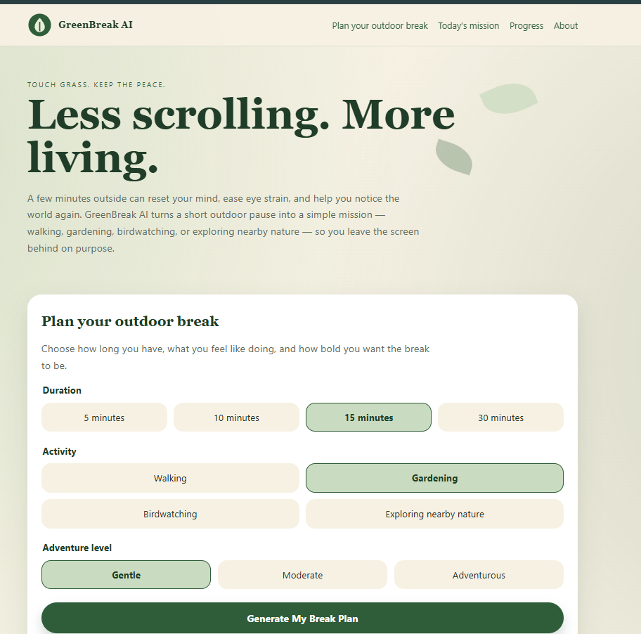
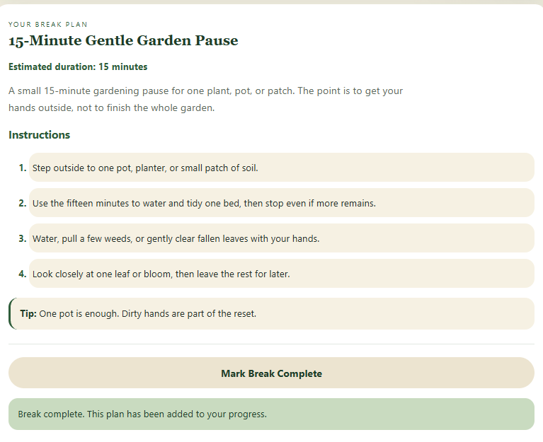
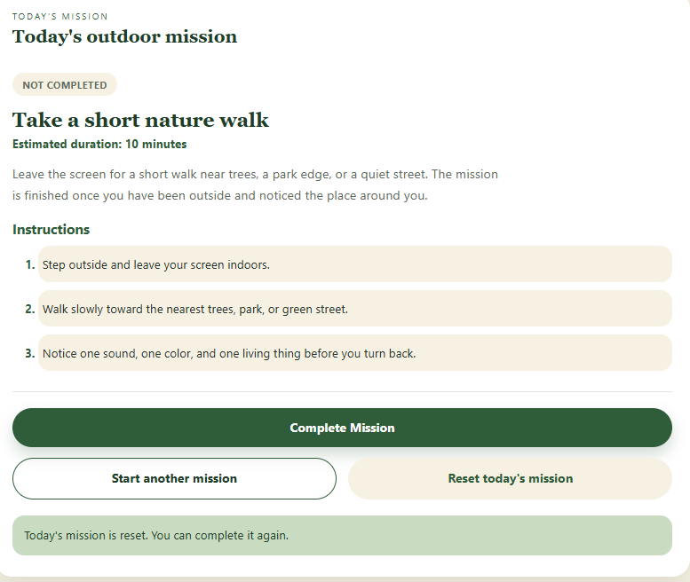
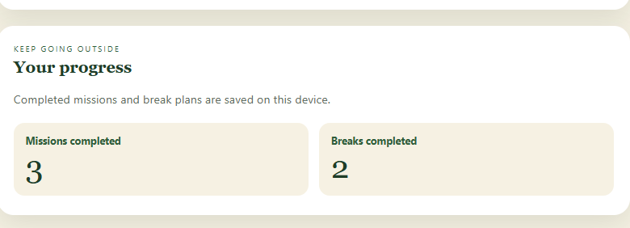

# GreenBreak AI

**Less scrolling. More living.**

GreenBreak AI is a small local website that helps you step away from a screen for a few minutes. You choose how long you have and what you feel like doing. The app turns that into a simple outdoor break: a short walk, a bit of gardening, a pause to watch birds, or a look at nearby nature.

It was built for Hacktoberfest 2026 DEV Community Week 1: **Touch Grass**.

Break plans come from predefined templates on your computer. The app does not call a live AI model, and it does not need a paid AI API or an API key.

## The problem

Short breaks are easy to spend scrolling. GreenBreak AI makes the outdoor option the default: a concrete plan, a daily mission, and a record of what you actually finished.

## Goals

- Offer a break you can start without an account or a paid AI service.
- Keep the plan specific: a title, steps, a duration, and a tip.
- Give the day one outdoor mission, with a way to finish it or choose another.
- Remember completed missions and break plans in the browser.

## Features

### Personalized outdoor break planner

- Durations: 5, 10, 15, and 30 minutes.
- Activities: walking, gardening, birdwatching, and exploring nearby nature.
- Adventure levels: Gentle, Moderate, and Adventurous.
- Each plan includes a title, instructions, an estimated duration, and a tip.
- Generating a plan does not count as finishing it. Use **Mark Break Complete** when you have done it. That plan is counted once.

### Today's outdoor mission

- One mission for the day, chosen from a fixed set of outdoor missions.
- Each mission has a title, a short description, instructions, and an estimated duration.
- **Complete Mission**, **Start another mission**, and **Reset today's mission**.
- A completed mission shows a status and a success message. Completing the same mission again, or refreshing the page, does not add another count.
- Resetting today's mission clears only that day's status. It does not erase your lifetime totals. Completing the mission again after a reset counts as a new completion.

### Progress tracking

- Separate totals for completed missions and completed break plans.
- An empty state when both totals are still zero.
- Progress is stored in the browser with `localStorage` and restored after a refresh.

### Interface

- Cream background and forest-green styling.
- Navigation to **Plan your outdoor break**, **Today's mission**, **Progress**, and **About**.
- Layouts that stack on a narrow screen, with visible keyboard focus.

## How plans are generated

Break plans are filled in on your computer from predefined templates in `backend/activity_service.py`. The browser sends your duration, activity, and adventure level only to the local FastAPI app.

No paid AI API and no API key are required. Plan text is not produced by a live model.

`backend/ollama_client.py` is still in the repository from an earlier experiment. The running site does not use it to generate plans.

## Screenshots

Landing page and the break planner.



A generated break plan, with steps, a tip, and **Mark Break Complete**.



Today's outdoor mission, with complete, switch, and reset actions.



Progress totals saved on this device.



## Technology stack

| Piece | What this project uses |
| --- | --- |
| Backend | Python, [FastAPI](https://fastapi.tiangolo.com/), [Uvicorn](https://www.uvicorn.org/) |
| Validation | [Pydantic](https://docs.pydantic.dev/) |
| Frontend | HTML, CSS, and JavaScript. No frontend framework and no build step. |
| Tests | [pytest](https://docs.pytest.org/) with FastAPI's `TestClient` |
| HTTP client library | `httpx` is listed in `requirements.txt`. The current break planner does not call an external service. |

There is no `package.json` and no `pyproject.toml`. Python dependencies are pinned in `requirements.txt`.

## Project structure

```text
GreenBreak/
├── backend/
│   ├── __init__.py
│   ├── main.py              # FastAPI app and static file routes
│   ├── activity_service.py  # Local break-plan templates
│   ├── schemas.py           # Request and response models
│   └── ollama_client.py     # Unused by the current planner
├── docs/
│   ├── planner.png
│   ├── break-plan.png
│   ├── mission.png
│   └── Progress.png
├── frontend/
│   ├── index.html
│   ├── styles.css
│   └── app.js               # Planner, missions, and progress
├── tests/
│   ├── test_api.py
│   ├── test_activity_service.py
│   └── test_schemas.py
├── pytest.ini
├── requirements.txt
└── README.md
```

## Prerequisites

- Python 3.10 or newer (`str | None` is used in the backend).
- Node.js, only if you want the JavaScript syntax check. The website itself does not need Node.

## Installation

From the project folder in Windows PowerShell:

```powershell
python -m venv .venv
.\.venv\Scripts\Activate.ps1
python -m pip install -r requirements.txt
```

If activation is blocked, run this once in that PowerShell window, then activate again:

```powershell
Set-ExecutionPolicy -Scope Process -ExecutionPolicy Bypass
```

## Run the app locally

Keep the virtual environment activated, then start the server:

```powershell
python -m uvicorn backend.main:app --host 127.0.0.1 --port 8000
```

Leave that terminal open while you use the site. Stopping the command stops the site.

Open [http://127.0.0.1:8000](http://127.0.0.1:8000).

The app is for local use. It is not deployed yet, and it is not set up as a production server.

Useful routes:

| Method | Path | Purpose |
| --- | --- | --- |
| `GET` | `/` | The website |
| `GET` | `/api/health` | Reports that local templates are available |
| `POST` | `/api/generate` | Builds a break plan from the selected options |

## How to use it

1. Open **Plan your outdoor break**.
2. Choose a duration, an activity, and an adventure level. The form starts at 5 minutes, Walking, and Gentle.
3. Click **Generate My Break Plan**. The plan appears under the planner.
4. After you do the break, click **Mark Break Complete**.
5. Open **Today's mission** for the day's outdoor task. Complete it, start another, or reset today.
6. Open **Progress** to see how many missions and break plans you have finished.
7. **About** is the short note at the bottom of the page.

## Tests and checks

Automated tests, from the project folder with the virtual environment activated:

```powershell
python -m pytest
```

`pytest.ini` adds the project root to the Python path and collects tests from `tests/`. The tests cover request validation, template plans, and the pages the server returns. They do not open a browser.

JavaScript syntax check:

```powershell
node --check frontend/app.js
```

## Progress and localStorage

Progress stays in this browser only. It is not stored on a server and is not synced between devices.

| Key | What it stores |
| --- | --- |
| `greenbreak.todayMission` | Today's mission and whether it is completed |
| `greenbreak.progress` | Lifetime mission and break totals, plus keys used to ignore duplicate completions |

Clearing site data for `127.0.0.1` removes that history. A new browser profile starts at zero.

## Privacy and limitations

- Plan text comes from templates shipped with the app, not from a live model.
- Your selected duration, activity, and adventure level are sent only to the FastAPI process on your machine.
- Mission completion and progress never leave the browser except as `localStorage` on that computer.
- The same break plan cannot be counted twice. Refreshing the page does not add a count.
- Resetting today's mission lets you complete that mission again, which adds one to the mission total. Earlier totals stay.
- There is no user account, no database, and no public deployment.

## Possible next steps

- Grow the mission and break-plan templates.
- Decide whether `backend/ollama_client.py` should be removed or kept for a future optional local model.

## Hacktoberfest

GreenBreak AI was made for Hacktoberfest 2026 DEV Community Week 1: **Touch Grass**.
